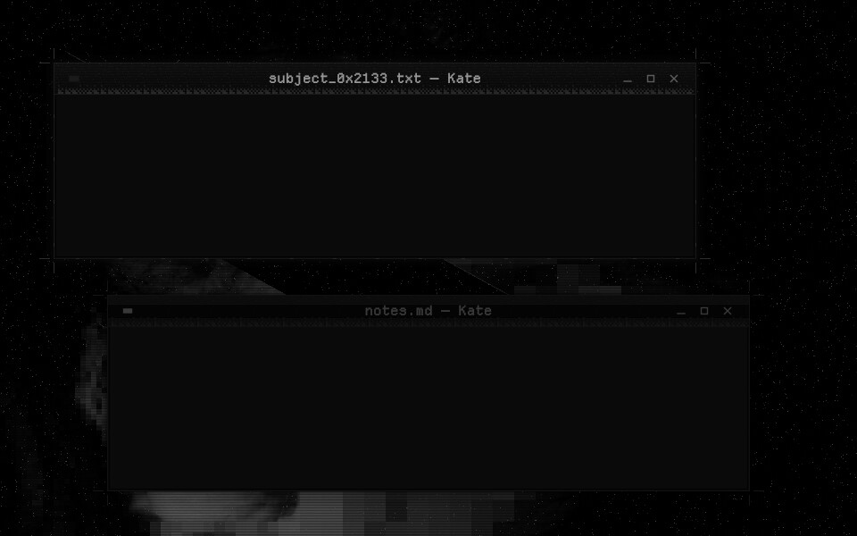
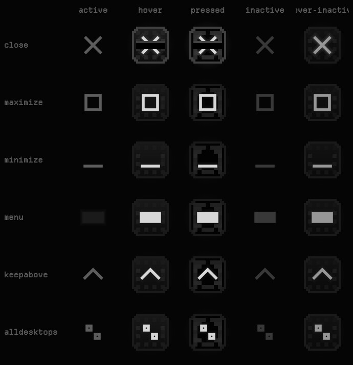
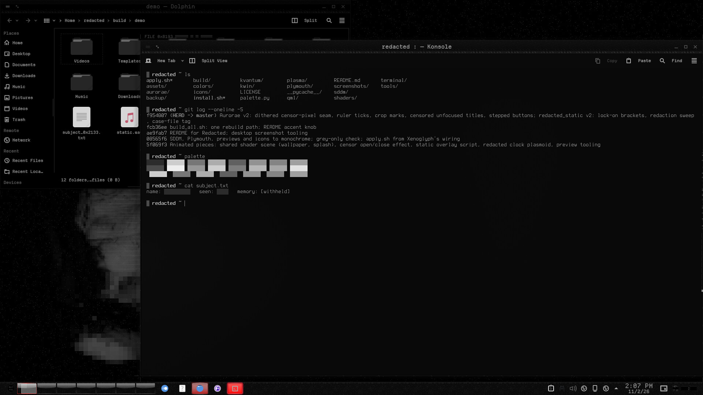

# Redacted — Aurorae Window Decoration

A black window frame like a censored file: a scanlined title bar over a dithered seam of censor pixels, measurement ticks, crop marks at the corners. Unfocused windows get a censor bar through the title.



Redacted is a monochrome-black look for KDE Plasma 6 about obfuscation and censorship. Every colour is a neutral grey, and the accents sit only a few levels above black: almost imperceptible, but just perceptible. The motifs are static, mosaic pixelation, black censor bars and a dissociated double.

## Features

- **Title bar:** faint grain and scanlines. The seam under it is made of 2 px censor pixels, ordered-dithered from dense to sparse.
- **Ruler:** measurement ticks hang off the top hairline, long every 48 px and short every 12.
- **Crop marks:** print crop marks sit in the shadow just outside each corner, as if the window had been cut out of a file. The active window adds a registration pip.
- **Unfocused windows:** a black censor bar runs through the title bar, and the title text sits on it.
- **Buttons:** pixel-stepped plates that light up with a dithered mosaic rim. On hover, the close ✕ gets struck out by a censor bar. The window-menu button is a censor block.
- **Tiled borders:** every border tiles at its natural size, so no detail stretches or smears at any window size.
- Centred title, 3 px borders, square corners.





## Requirements

KWin (Plasma 6) with Aurorae.

## Install

```bash
git clone https://github.com/numbpill3d/redacted-aurorae
cd redacted-aurorae && ./install.sh
```

Or from the KDE Store: System Settings → Colors & Themes → Window Decorations → Install from File, or extract it to `~/.local/share/aurorae/themes/`.

## The rest of the suite

| piece | repo |
|---|---|
| Global theme + splash screen | [redacted-global](https://github.com/numbpill3d/redacted-global) |
| Plasma style (panel, popups) | [redacted-plasma](https://github.com/numbpill3d/redacted-plasma) |
| Colour scheme | [redacted-colors](https://github.com/numbpill3d/redacted-colors) |
| Kvantum widget style | [redacted-kvantum](https://github.com/numbpill3d/redacted-kvantum) |
| Icon theme | [redacted-icons](https://github.com/numbpill3d/redacted-icons) |
| Konsole + kitty colours | [redacted-konsole](https://github.com/numbpill3d/redacted-konsole) |
| SDDM login | [redacted-sddm](https://github.com/numbpill3d/redacted-sddm) |
| Plymouth boot splash | [redacted-plymouth](https://github.com/numbpill3d/redacted-plymouth) |
| Animated wallpaper (desktop + lock) | [redacted-wallpaper](https://github.com/numbpill3d/redacted-wallpaper) |
| Still wallpaper (1080p–4K) | [redacted-image-wallpaper](https://github.com/numbpill3d/redacted-image-wallpaper) |
| KWin open/close effect | [redacted-censor](https://github.com/numbpill3d/redacted-censor) |
| KWin script: active window under review | [redacted-static](https://github.com/numbpill3d/redacted-static) |
| Clock plasmoid | [redacted-clock](https://github.com/numbpill3d/redacted-clock) |

Everything at once, with the generators: [redacted](https://github.com/numbpill3d/redacted).

## Tags

`redacted` `kde` `plasma6` `dark` `black` `monochrome` `grayscale` `minimal` `censored` `glitch` `static` `pixel` `aurorae` `window-decoration` `kwin` `titlebar` `pixel-art`

## Credits and licence

By splicer scorn (voidrane). GPL-3.0-or-later.
